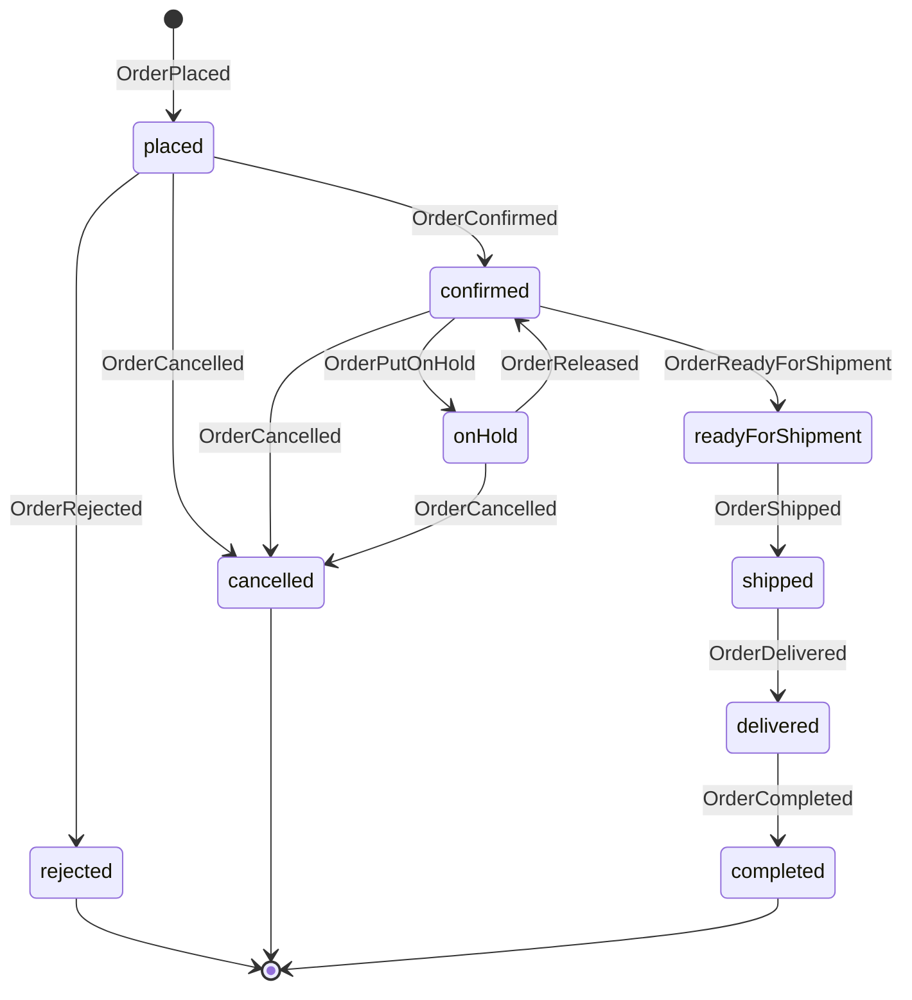
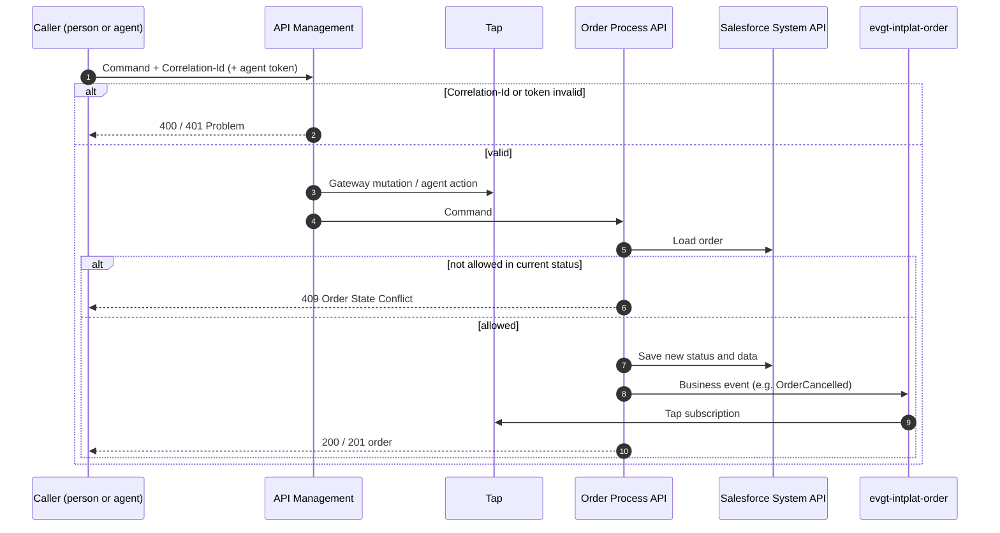
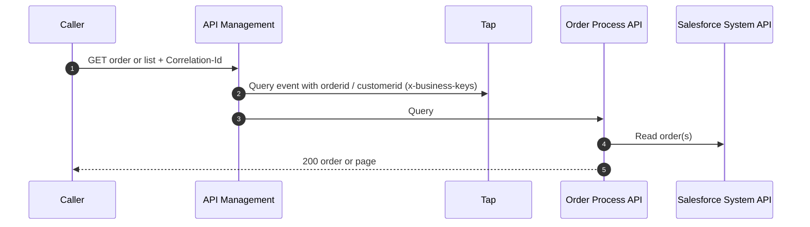

# process-api-order

The **Order Process API** of the order domain: the lifecycle of an order across systems. Owned by
the **order domain team**. Decision:
[ADR 0013](https://github.com/azure-intelligence-domain/ai-intelligence-domain/blob/main/docs/adr/0013-order-domain.md).

> Version 0.x: designed (contracts, flows), not implemented yet.

| File | What |
|---|---|
| [`openapi.yaml`](openapi.yaml) | Commands and queries: `[Order] Order Process API` |
| [`asyncapi.yaml`](asyncapi.yaml) | The 15 business events of the order domain, on `evgt-intplat-order` |
| [`docs/bpmn/`](docs/bpmn/) | The flows as BPMN 2.0: order to delivery, commands, queries |
| [`docs/problems/`](docs/problems/) | Problem types: invalid request, order not found, order state conflict |

Both contracts follow the adidas API guidelines and pass the platform's contract check.

## Language: business facts, not CRUD

Events are named after what happened in the business (Event Storming), in the past tense. An order
is never *updated* or *deleted*; it is amended, rescheduled, put on hold, cancelled.

| Command | API | Event |
|---|---|---|
| Place Order | `POST /orders` (with `Idempotency-Key`) | **OrderPlaced** |
| Retrieve Order | `GET /orders/{orderId}` | *query, tapped with `orderid`* |
| Retrieve List of Orders | `GET /orders?customerId=&status=&offset=&limit=` | *query, tapped with `customerid`* |
| Amend Order Lines | `PUT /orders/{orderId}/order-lines` | **OrderAmended** |
| Change Delivery Address | `PUT /orders/{orderId}/delivery-address` | **OrderDeliveryAddressChanged** |
| Reschedule Delivery | `PUT /orders/{orderId}/requested-delivery-date` | **OrderDeliveryRescheduled** |
| Put Order on Hold / Release Order | `PUT` / `DELETE /orders/{orderId}/hold` | **OrderPutOnHold** / **OrderReleased** |
| Cancel Order (soft delete) | `DELETE /orders/{orderId}?reason=` | **OrderCancelled** |

Facts from other domains become order facts through policies:

| When (other domain) | Then (order domain) |
|---|---|
| The ERP confirms or refuses | **OrderConfirmed** / **OrderRejected** |
| Finance: InvoiceIssued | **OrderInvoiced** |
| Finance: PaymentReceived (invoice covered) | **OrderPaid** |
| Supply: StockReserved | **OrderReadyForShipment** |
| Logistics: ShipmentDispatched / ShipmentDelivered | **OrderShipped** / **OrderDelivered** |
| OrderDelivered and OrderPaid both happened | **OrderCompleted** |

## Order status

A state machine; payment status (`unpaid`, `invoiced`, `paid`) is separate, so an order can be
shipped and still unpaid. An invalid transition is
[`409 Order State Conflict`](docs/problems/order-state-conflict.md).

## Flows (BPMN)

The `.bpmn` files are the source: open them in Camunda Modeler or
[demo.bpmn.io](https://demo.bpmn.io), or view them in
[EventCatalog](https://azure-intelligence-domain.github.io/eventcatalog/docs/domains/order/1.0.0).
GitHub cannot render BPMN, so here is the Mermaid version of the same flows.

### Order to delivery ([`order-to-delivery.bpmn`](docs/bpmn/order-to-delivery.bpmn))

### Commands ([`order-commands.bpmn`](docs/bpmn/order-commands.bpmn))

### Queries ([`order-queries.bpmn`](docs/bpmn/order-queries.bpmn))

Every retrieval is tapped, so the Intelligence domain can see how often orders are looked at, and
by whom: "ACME's order 4711 was retrieved 5 times by customer service today".
